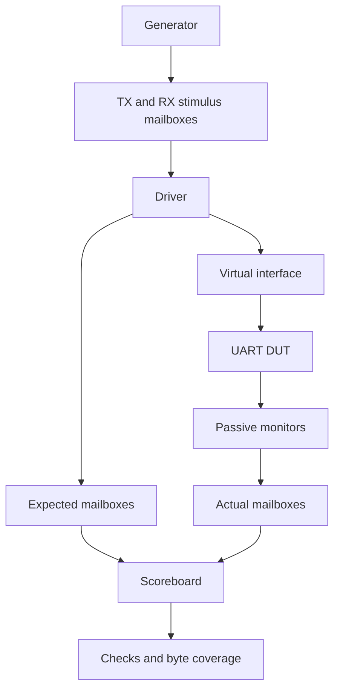

# UART Transmitter and Receiver — Layered Testbench

A complete, self-checking **SystemVerilog** project containing synthesizable UART transmitter/receiver RTL and a **class-based, non-UVM layered verification environment**.

## Features

- Full-duplex UART: TX and RX operate independently and are tested concurrently.
- Fixed **8N1** framing: idle high, one low start bit, eight data bits LSB first, one high stop bit.
- Parameterized integer clocks per bit, asynchronous active-low reset, two-flop RX synchronizer.
- TX busy and one-cycle done signals; RX valid and framing-error pulses.
- Transactions, generator, driver, passive monitors, scoreboard, and environment classes communicating through typed mailboxes and a virtual interface.
- Directed patterns, exhaustive byte sweeps, reproducible random traffic, back-to-back RX frames, error injection, reset interruption, false-start rejection, and requests while TX is busy.
- Assertions, byte-coverage counters, watchdog timeout, optional VCD waveforms, and GitHub Actions regression.

## Project contents

| Path | Purpose |
|---|---|
| `rtl/uart_tx.sv` | Serial transmitter and ten-bit frame timing |
| `rtl/uart_rx.sv` | Input synchronization, start qualification, receive sampling |
| `rtl/uart.sv` | Full-duplex wrapper |
| `tb/uart_if.sv` | DUT/testbench signal interface |
| `tb/uart_transaction.svh` | Byte, direction, stop-error and idle-gap transaction |
| `tb/uart_generator.svh` | Directed, exhaustive, and random stimulus |
| `tb/uart_driver.svh` | Parallel TX-request and RX-serial drivers |
| `tb/uart_monitor.svh` | Independent TX serial decoder and RX output monitor |
| `tb/uart_scoreboard.svh` | Expected/actual comparison and byte coverage |
| `tb/uart_environment.svh` | Component construction and concurrent execution |
| `tb/uart_pkg.sv` | Class compilation order and simulation timing |
| `tb/tb_uart.sv` | Clock, reset, directed checks, assertions and test entry point |
| `sim/files.f` | Ordered source file list |
| `sim/run_questa.do` | Optional Questa batch script |
| `Makefile` | Build, test, regression, wave and cleanup targets |
| `docs/TEST_PLAN.md` | Verification matrix and limitations |
| `docs/VALIDATION.md` | Actual local validation results |
| `docs/validation.txt` | Captured simulation output |
| `.github/workflows/simulation.yml` | Automated regression after push/PR |

## Layered architecture



The TX scoreboard compares requested bytes against bytes decoded from the **serial TX pin**. The RX scoreboard compares independently driven serial frames against the DUT's **parallel data and error outputs**. TX is deliberately not wired to RX: a shared TX/RX bug should not cancel out in a loopback-only test.

## Run with Verilator

Run every command from the project root. A modern Verilator with SystemVerilog classes, mailboxes, timing and assertion support is required, together with GNU Make and a C++ compiler. The tested Linux setup used Python 3.12, the `verilator==5.48.0` wheel and a C++20-capable compiler. The bundled simulator reports Verilator 5.49; the package version and runtime banner differ. The CI workflow pins this same package. Older distribution-provided Verilator versions may lack required class support.

If a suitable `verilator` executable is already on PATH:

```bash
make test
make regression
make test SEED=42 N_RANDOM=500
make waves
```

For the tested Python package setup on Linux:

```bash
python3 -m venv .venv
. .venv/bin/activate
python -m pip install verilator==5.48.0
make test VERILATOR=verilator-cli
make regression VERILATOR=verilator-cli
make waves VERILATOR=verilator-cli
```

On macOS, use a native Verilator installation with the required features and `make test`, or run the supplied GitHub Actions workflow on Linux after pushing. The Python wheel path above was validated on Linux, not macOS.

`SEED` controls simulation randomization. `N_RANDOM` adds that many random bytes **per direction**, in addition to the fixed directed/exhaustive suite; accepted range is 0–10000. Each regression runs seeds 1, 7, 42, and 2026. A failure uses `$fatal` and returns a nonzero status. A 250 ms simulation watchdog catches hangs.

Expected default summary:

```text
PASS: reset interruption and false-start rejection
PASS: TX=360 RX=376 framing_errors=16
Byte coverage: TX=256/256 RX=256/256
PASS: TX frame duration and done count=360
```

The 376 RX events comprise 360 valid bytes and 16 framing errors. Coverage here means explicit per-byte functional counters, **not** code coverage or a simulator covergroup database.

`make waves` writes `build/uart.vcd`. Open it with a VCD-capable viewer; inspect `tb_uart.bus` signals. `make clean` removes generated build output. VCD files and compiled objects are excluded from Git.

### Optional Questa flow

```bash
vsim -c -do sim/run_questa.do
```

This script is supplied for convenience and was not executed locally. A license with full SystemVerilog class support is needed. The Verilator regression is the validated flow. Icarus Verilog is not the target simulator for this class-based testbench.

## UART interface contract

All inputs except serial RX are synchronous to `clk`. Reset is active low and asynchronously clears both blocks. Integrate reset deassertion appropriately for the target hardware.

| Signal | Direction | Meaning |
|---|---|---|
| `clk`, `rst_n` | Input | Clock and active-low reset |
| `tx_data[7:0]` | Input | Byte sampled on accepted request |
| `tx_start` | Input | Assert for one clock when `tx_busy` is low |
| `tx` | Output | Serial output, idle high |
| `tx_busy` | Output | High for all ten frame bits |
| `tx_done` | Output | One clock pulse after the complete stop bit |
| `rx` | Input | Asynchronous serial input |
| `rx_data[7:0]` | Output | Last successfully received byte |
| `rx_valid` | Output | One clock pulse when `rx_data` updates |
| `rx_error` | Output | One clock pulse on a low stop-bit sample |

Requests while TX is busy are discarded; there is no queue or ready/valid backpressure. A request present on the clock where busy clears is still ignored. Pulse a new request on a subsequent clock with busy low. Holding `tx_start` high can cause repeated frames after the block becomes idle.

RX validates the start bit near its midpoint, samples eight data bits one bit apart, and checks the stop bit near its midpoint. A framing error does not assert valid or update the last good data. After an error, return the line high before another frame. Continuous break detection and break recovery are not implemented.

## Baud-rate configuration

The RTL parameter is `CLKS_PER_BIT`; actual baud rate is:

```text
actual_baud = clock_frequency / CLKS_PER_BIT
```

Choose the nearest appropriate integer divider for your clock and desired baud rate, and check the resulting baud error against your peer's tolerance. The RTL accepts dividers of at least 4; the supplied verification configuration validates **16 only**. Hardware use requires timing/CDC review and verification at your actual divider.

The default testbench has a 100 MHz clock (10 ns period) and divider 16, giving a fast simulation baud rate of 6.25 Mbaud. This is a simulation setting, not a claim about a particular board or physical serial link. `tb/uart_pkg.sv` defines `CPB` and `BIT_TIME`; if you change the clock period, update `BIT_TIME` to match. The full regression must be rerun after timing changes.

## Push this project to your GitHub repository

The folder name deliberately includes the final hyphen to match the repository in the screenshot. After extracting the ZIP into Downloads on your Mac, run:

```bash
cd ~/Downloads/UART-Transmitter-and-Receiver-Layered-TestBench-
git init
git add .
git commit -m "Add UART TX RX RTL and layered SystemVerilog testbench"
git branch -M main
git remote add origin https://github.com/Adiolus/UART-Transmitter-and-Receiver-Layered-TestBench-.git
git push -u origin main
```

These commands assume the remote is still empty, as shown in the screenshot. Adjust the `cd` path if you extracted elsewhere. Authenticate with your GitHub account when requested. If Git asks for identity, configure your own `user.name` and `user.email` before committing. If the remote has acquired commits, fetch and reconcile them instead of force-pushing.

## Scope

This is an educational UART RTL and verification project. It does not include parity, configurable word/stop lengths, FIFOs, flow control, a CPU bus, FPGA pin constraints, or a physical RS-232 voltage interface. No synthesis, hardware timing, metastability, or silicon signoff is claimed. See the test plan for further boundaries.
